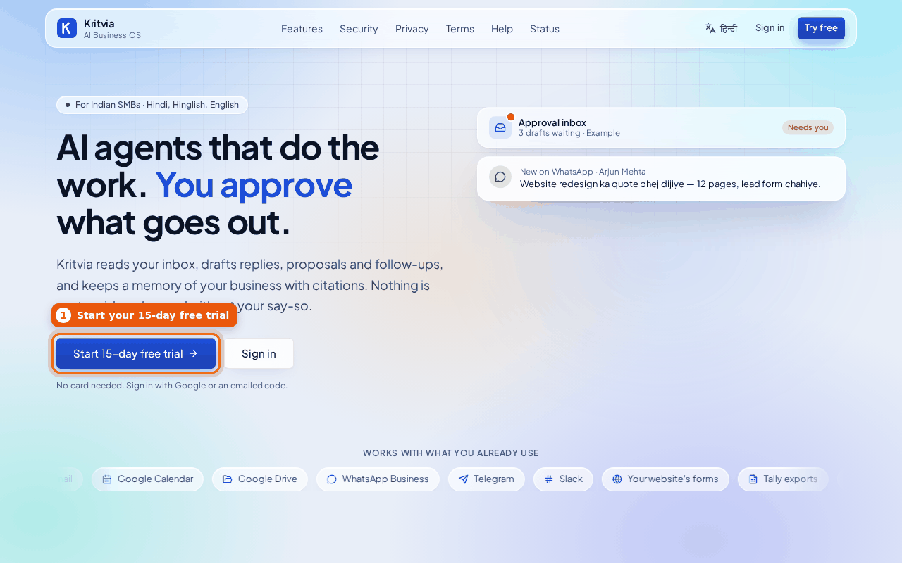
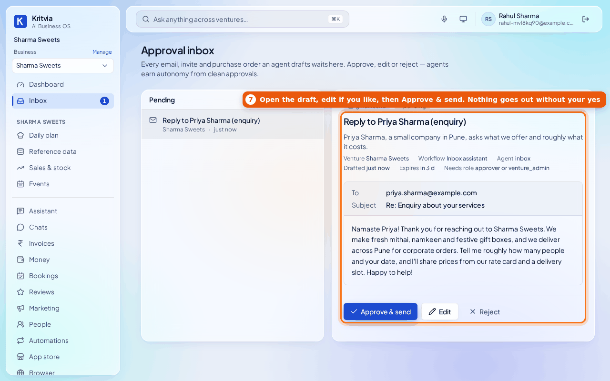
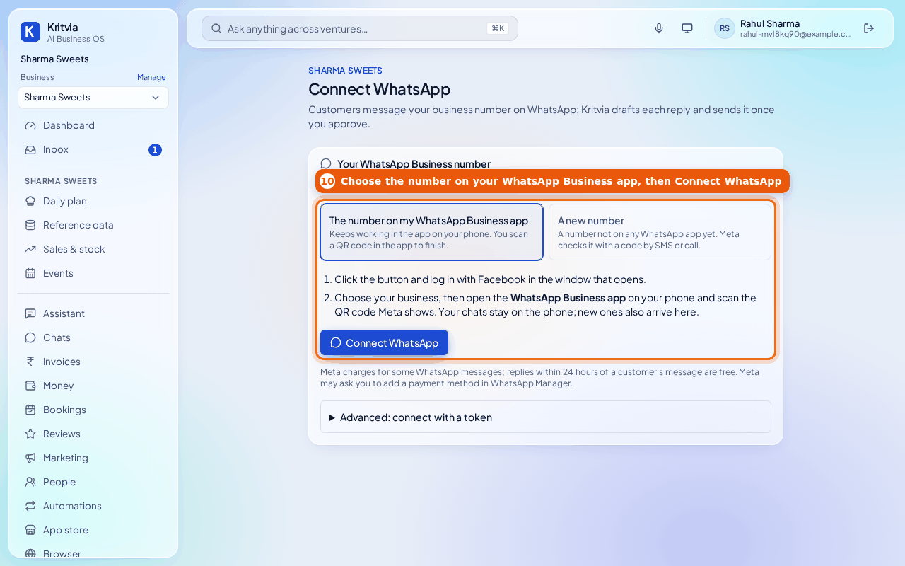
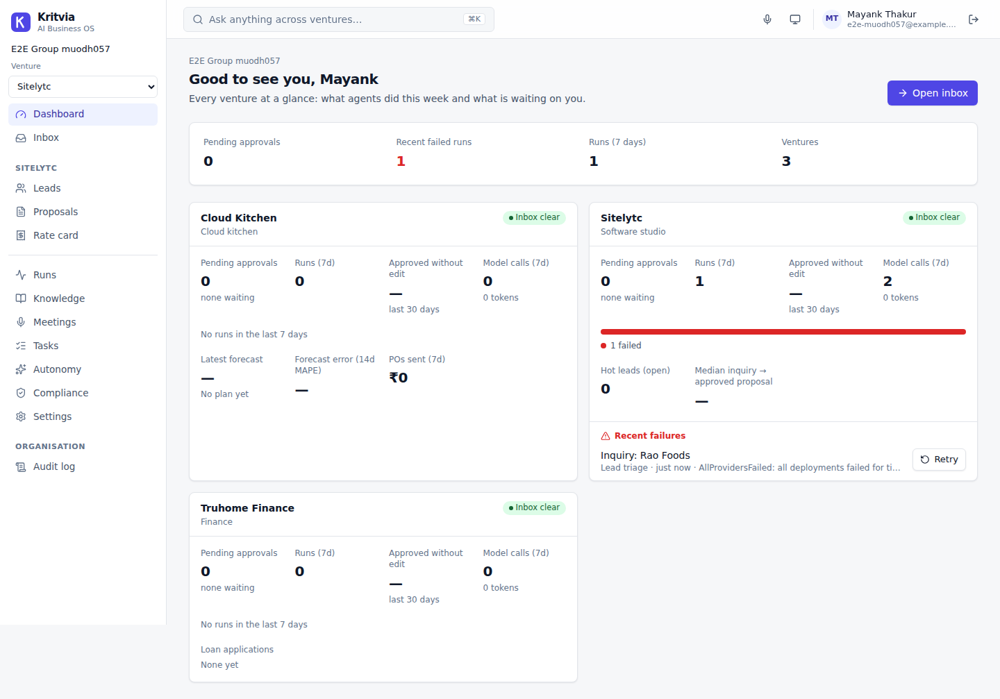
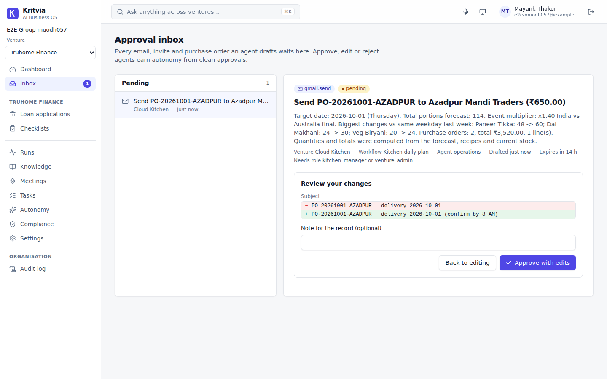
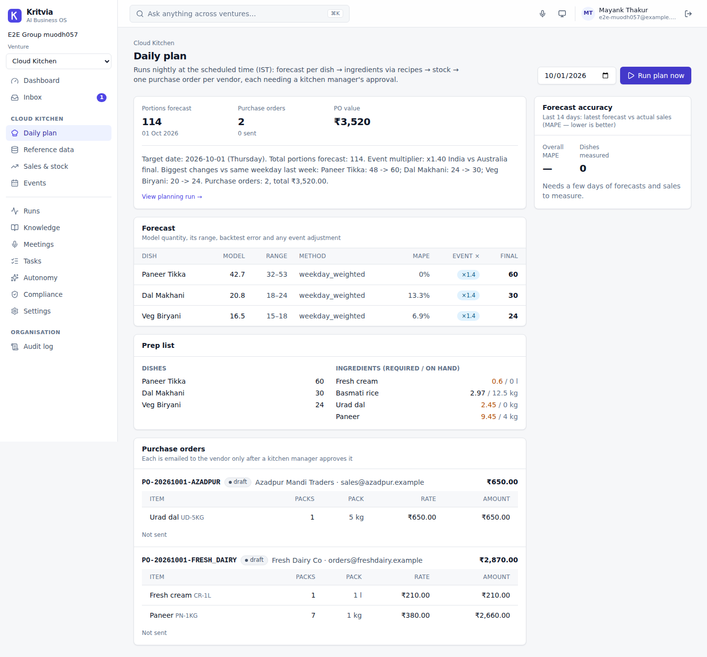
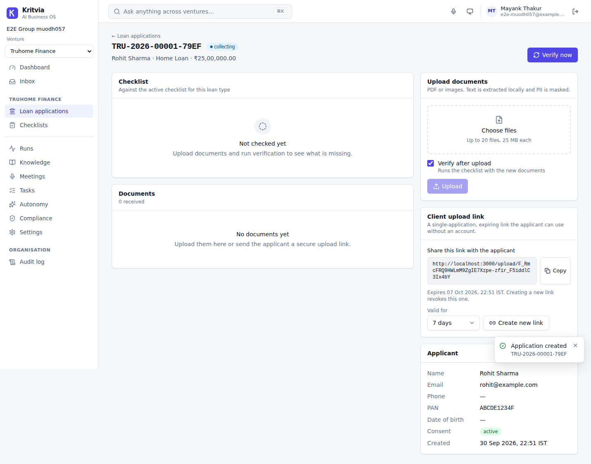
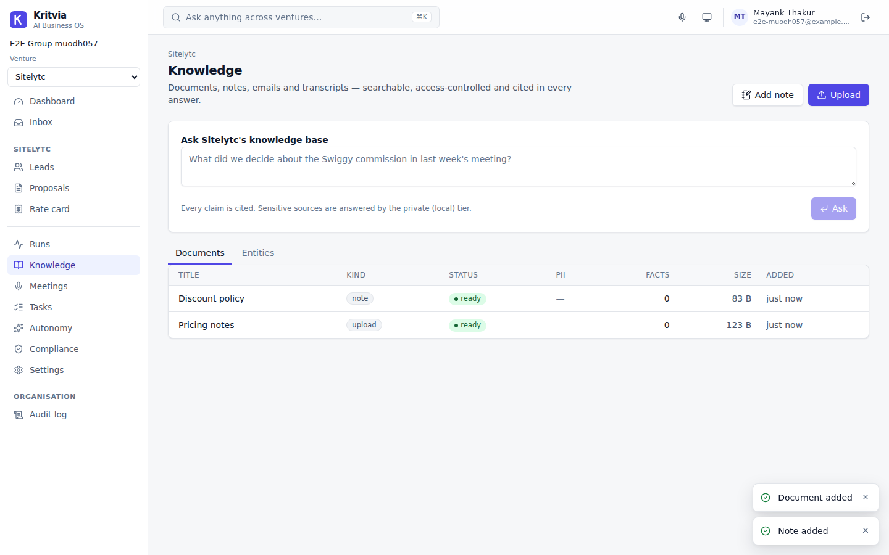
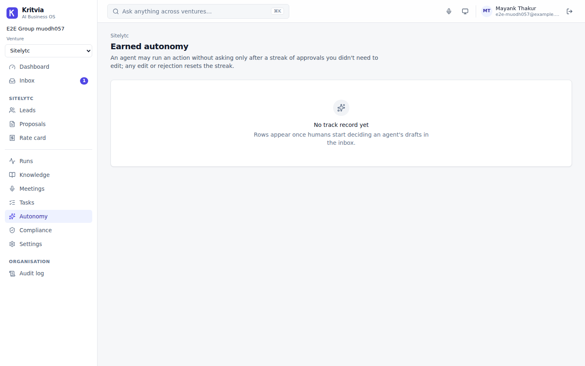

# Kritvia — AI Business Operating System

AI agents for Indian small businesses. They read the business's messages, draft the work in Hindi,
Hinglish or English, and wait for the owner's yes before anything is sent, paid or changed. Built by
Sitelytc Digital Media; live at **[app.sitelytc.com](https://app.sitelytc.com)** (API at `api.sitelytc.com`).

**Status: live, in pilot.** 649 API tests (incl. exploit regressions and a sweep of every route with
foreign ids), 297 web unit tests, 38 end-to-end tests and the desktop app's tests. 77 forward-only migrations.

**New here? → [Onboard a business, step by step (with screenshots)](docs/onboarding.md)**

| Start the trial | Approve the first draft | Connect WhatsApp |
|---|---|---|
|  |  |  |

## What it does

The full list, plan by plan, is the [/features](https://app.sitelytc.com/features) page
(`apps/web/lib/features.ts`). In short:

* **One inbox for every channel.** Email (Gmail or forwarding), WhatsApp Business, Telegram, Slack, the
  website's form and IndiaMART. Each message is sorted and gets a draft reply in the business's voice.
* **The answering machine.** Customers asking about their *own* invoices, payment links, bookings and
  shipments get the numbers from the records. If the business switches it on, the inbox assistant also
  **replies by itself** in a warm, professional or playful tone; orders, bookings, payments, prices not
  on the rate card, discounts, refunds, disputes, complaints and promises still wait for a yes, and it
  never claims to be a person. The owner asks the business anything from their own WhatsApp, Telegram,
  Slack or email. → [docs/agents/answering-machine.md](docs/agents/answering-machine.md)
* **WhatsApp coexistence.** Connect the number already on the WhatsApp Business app (QR code in the app)
  or a new number, through Meta's Embedded Signup. → [docs/agents/whatsapp.md](docs/agents/whatsapp.md)
* **Agents for each job:** lead triage and priced proposals (from the rate card, by code), payment
  reminders and UPI/Razorpay links, GST invoices and GSTR-1, bank-statement matching, bookings, Google
  reviews, social posts and campaigns, AI phone calls, hiring and WhatsApp attendance, loan document
  checks, the cloud-kitchen demand plan and purchase orders, export shipment files, the Prospector, and
  your own skills and automations.
* **The assistant and the App store.** Ask in plain words (typed or spoken) and the assistant works across
  every page and agent; connect other apps through the MCP Registry or any OpenAPI description.
  → [docs/app-store.md](docs/app-store.md)
* **Hindi throughout.** The interface switches to Hindi; drafts follow the customer's language.
  → [docs/hindi.md](docs/hindi.md)

## How the pieces fit

```
apps/api            FastAPI: tenancy/RLS, auth, crypto, model router, workflow engine, all REST routes
  kritvia_api/engine      durable workflows: steps, checkpoints, approval interrupts, leases, policy engine
  kritvia_api/workflows   inbox · lead_triage · collections · booking_reminders · reviews · social · campaign
                          voice_call · hiring · loan_verification · kitchen · trade · prospector · custom · …
  kritvia_api/services    memory and cited Q&A, messaging, customer_facts, auto_reply, ask_anywhere,
                          run_trust, netguard, google, pollers, OCR, …
apps/api/migrations forward-only, checksummed SQL (0001 foundation … 0077 auto-reply)
apps/worker         arq worker: runs, schedules, sweeper, pollers, retention, morning check
apps/web            Next.js 15: public site, BFF auth, approval inbox, venture views, settings, voice widget
apps/desktop        Kritvia Voice: Electron tray app for dictation into any app
services/           sandbox (gVisor jobs) · browser (browser agent) · mcp-runner (App store apps) · diarization
packages/shared-types  OpenAPI schema + generated TypeScript types (CI fails if stale)
infra               docker compose, LiteLLM tiers, Postgres roles, deploy/backup/health scripts
docs                onboarding, architecture, decisions (ADRs), runbook, agents/, security/, compliance/
```

* **Isolation in the database.** The API and worker connect as `kritvia_app` (no BYPASSRLS, owns nothing).
  Every tenant table has `org_id`/`venture_id`, forced RLS and an audit trigger. A route sweep test attacks
  every endpoint with foreign ids.
* **Approvals are interrupts.** A step returns `Interrupt(ApprovalRequest)`; the run is checkpointed
  (encrypted) and parked until a person with the right role decides. Tools execute the *approved*
  payload, at most once.
* **What may skip approval is enforced twice.** Replying by itself is decided in code
  (`services/auto_reply.py`: hand-off topics, money and percentages not on record, claims to be human,
  automated senders, per-contact and per-business caps) **and** by a database trigger
  (`private.guard_approval_insert`) that refuses an auto-approved row unless it is the inbox agent, on a
  switched-on channel, not sensitive. Earned autonomy (a long run of unedited approvals) is audited and
  can be taken back.
* **LLMs reason, code calculates.** Prices, forecasts, totals, bank matching and checklist rules are code.
  Facts carry a mandatory source; answers cite them.
* **Models are configuration.** Workflows ask for a tier; `infra/litellm/tiers.yaml` maps tiers to fallback
  chains; sensitive requests only reach local or BYOK models.
* **Untrusted input stays untrusted.** Customer messages, web pages and app output taint a run
  (`services/run_trust.py`); outbound fetches go through `services/netguard.py` (public IPs only).
  → [docs/security/](docs/security/)
* **Tamper-evident audit log.** Per-org SHA-256 hash chain, append-only, verifiable from the UI and CLI.

## Run the tests

```bash
# Postgres 16 + pgvector on localhost as postgres/postgres
cd apps/api && pip install -e ".[dev]" && pytest -q
pnpm install && pnpm --filter @kritvia/web lint && pnpm --filter @kritvia/web typecheck \
  && pnpm --filter @kritvia/web test && pnpm --filter @kritvia/web build
pnpm --filter @kritvia/web e2e     # Playwright, against a local API and web build
```

## Try it in your browser (GitHub Codespaces)

[](https://codespaces.new/smayankthakur/Kritvia-Global-Dashboard?quickstart=1)

The dev container starts Postgres + pgvector, installs everything and seeds a demo workspace (three
ventures, rate card, loan checklist, 8 weeks of kitchen sales). The dashboard opens on port 3000.
Sign in with `demo@example.com` / `kritvia-demo-2026`. Restart later with `bash scripts/dev-up.sh`.
Model-driven steps need a model gateway — see the runbook.

## Run it

See **[docs/runbook.md](docs/runbook.md)**. In short:

```bash
cp .env.example .env            # fill secrets; back up MASTER_KEK_B64 offline
cd infra && docker compose build sandbox-jobs && docker compose --profile tunnel up -d
docker compose exec api python -m kritvia_api.cli bootstrap --email you@sitelytc.com --name "Your Name"
```

Deploys on the server: `sudo /opt/kritvia/infra/scripts/backup.sh`, then
`sudo /opt/kritvia/infra/scripts/deploy.sh --bg` (one deploy at a time; it waits for `/readyz` and ends
with `DEPLOY-DONE`). Local development without Docker: API `uvicorn kritvia_api.main:app` with
`DISPATCH_MODE=background`, web `pnpm --filter @kritvia/web dev` with `KRITVIA_API_URL=http://localhost:8000`.

## Proof

| Claim | Proven by |
|---|---|
| Venture A cannot read Venture B through any API route | `tests/test_isolation.py` (behavioural + automatic sweep of all routes + raw-SQL checks as the app role) |
| Every write is audited; the log is tamper-evident | `tests/test_audit.py` |
| Nothing auto-sends unless the business switched it on, and hand-off topics always wait | `tests/test_auto_reply.py`, `tests/test_customer_facts.py` (code and DB trigger) |
| A workflow pauses at an interrupt, survives a restart, resumes on approval | `tests/test_engine.py`, `tests/test_lead_triage.py` |
| Model calls route by tier and fall back; sensitive data stays local | `tests/test_model_router.py`, `tests/test_loan_verification.py` |
| Sandboxed code cannot reach the network | sandbox `/healthz` probe, CI `images` job, `tests/test_sandbox.py` |
| Answers cite working sources | `tests/test_memory.py` |
| Sign-up, onboarding and the first agent run work in a real browser | `apps/web/e2e/` |

## More screens

| Executive dashboard | Approval inbox — edit with diff |
|---|---|
|  |  |
| **Kitchen daily plan** | **Loan application checklist** |
|  |  |
| **Knowledge with cited answers** | **Earned autonomy** |
|  |  |

Voice: [vocabulary](docs/screenshots/25a-voice-vocabulary-desktop.png) ·
[dictation widget](docs/screenshots/voice-widget-learn.png). Third-party code: `THIRD_PARTY_NOTICES.md`.
