# Onboard a business, step by step

How a new business gets from the home page to its first approved reply, then connects its channels.
It takes about 10 minutes. The screenshots follow a made-up sweet shop, **Sharma Sweets**, owned by
**Rahul Sharma**; every name, email and code in them is an example.

Unless the owner picks **Autopilot** in step 5, nothing is sent to a customer without the owner's yes.
Replying by itself (step 12) is also off until the owner switches it on.

---

## 1. Start the free trial

Open **app.sitelytc.com** and click **Start 15-day free trial**. No card is needed.

## 2. Create the account

Tick **both** boxes (18 or older, and the Terms of Service and Privacy Policy), then either
**Sign up with Google** or type your name and work email and click **Email me a code**. The button
stays off until both boxes are ticked.

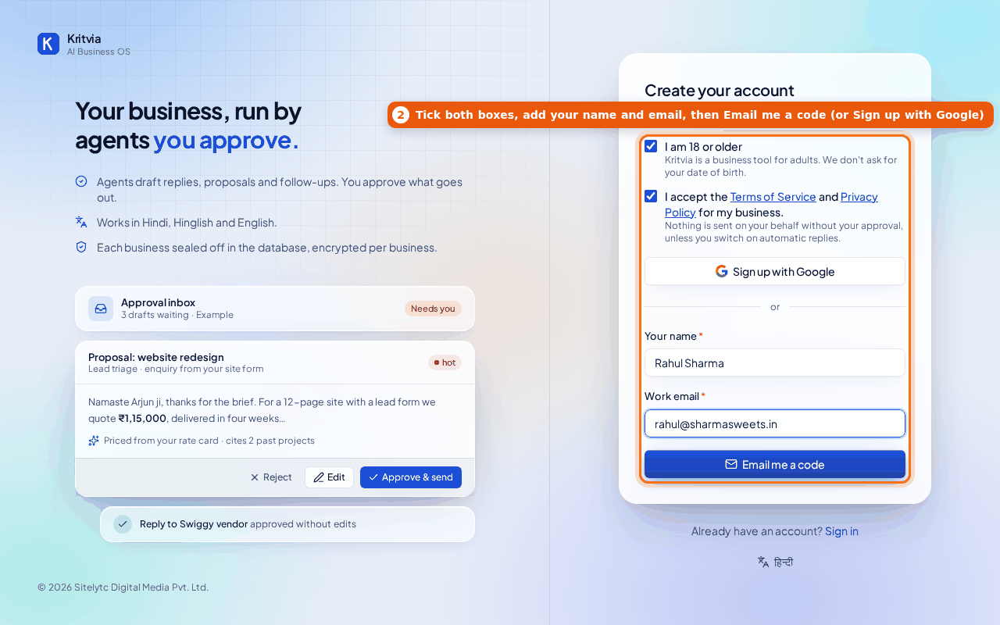

## 3. Enter the code from your email

Type the 6-digit code from the email (it works for 10 minutes) and click **Create account**.
If it hasn't arrived, check spam, or use **Send again** once the timer runs out.

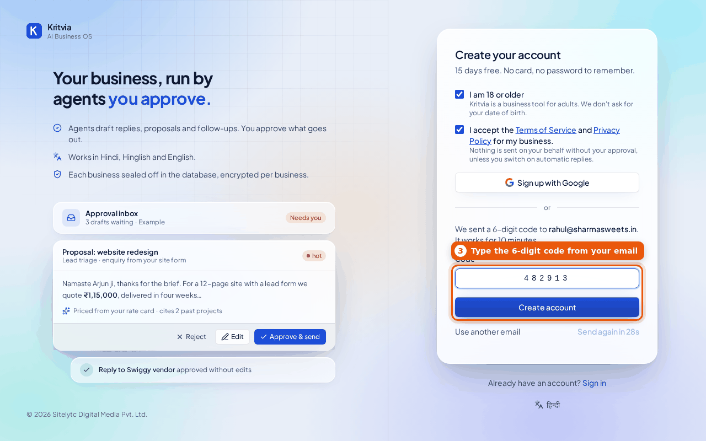

## 4. Tell Kritvia about your business

Type the business name and pick the card that describes what it does. The card decides which
agents start switched on. Click **Continue**. You can add more businesses later; each one is
kept completely separate.

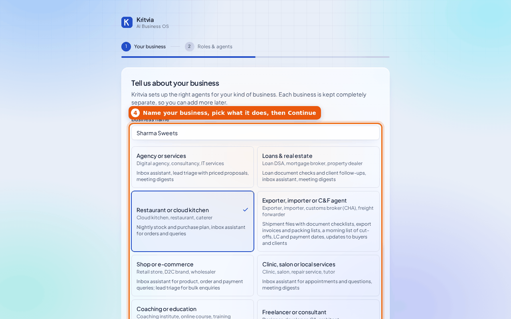

## 5. Roles and agents

Kritvia ticks the agents that suit your kind of business (agents made for other kinds sit under "More
agents"). Keep them, or tick and untick as you like (each line says what the agent does and when it runs).

Then choose how your agents work, **Autopilot** (recommended) or **I'll approve everything**. Nothing is
picked for you. With autopilot, agents reply, remind and follow up by themselves; money, complaints and orders
still come to you, and you get a summary at 8 pm (see [agents/autopilot.md](agents/autopilot.md)). You can
change it any time in Settings, or reply PAUSE from your linked Telegram or WhatsApp. Click **Finish setup**.

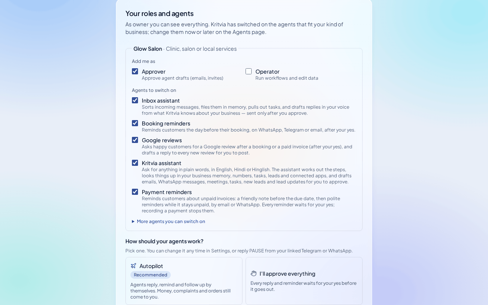

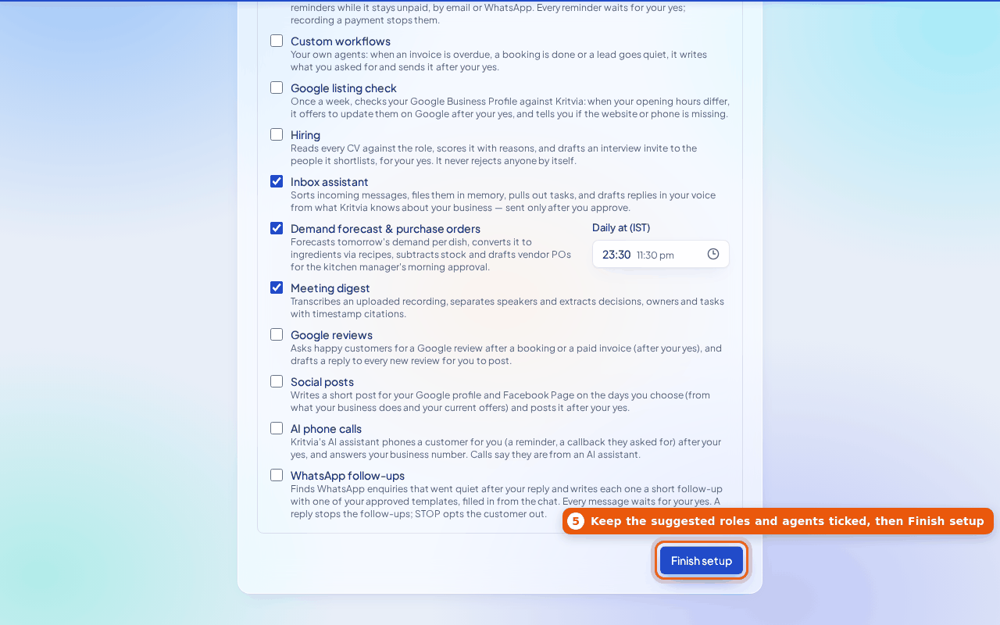

## 6. Watch your first agent run

Kritvia runs the Inbox assistant once on a **made-up** enquiry so you can see how an agent works:
each step on the timeline is its reasoning, and the draft reply goes to your Inbox. Nothing is sent
to anyone.

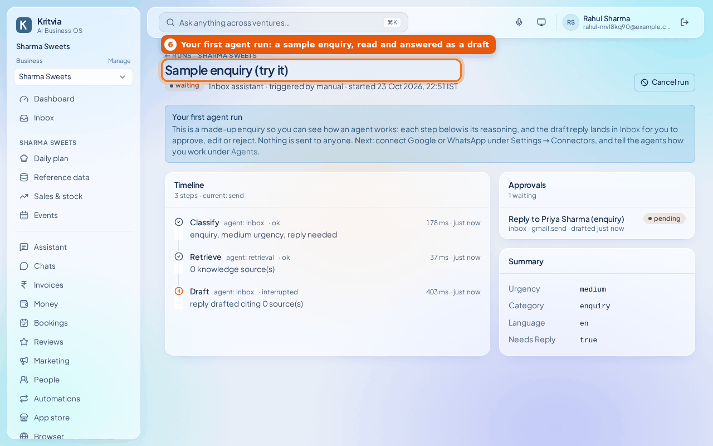

## 7. Approve your first draft

Open **Inbox**, click the draft, read it, change it with **Edit** if you like, then click
**Approve & send** (or **Reject**). Every email, WhatsApp reply, invite and purchase order an agent
drafts waits here. Kritvia learns from what you change.

## 8. Your home page

**Dashboard** shows what needs you today, and the **first win in 10 minutes** checklist shows what is
left: tell Kritvia about your business, approve the draft, get drafts on your phone, connect where
customers write, and (optionally) add an invoice with a payment link. Click **Do it** on any line.

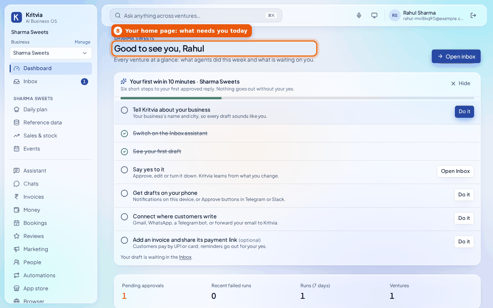

## 9. Connect where customers write

**Settings → Connectors.** Connect at least one channel so real customer messages come in:

- **Google Workspace**: Gmail enquiries in, approved emails and calendar invites out.
- **Email forwarding**: if you'd rather not connect Gmail, get an address and forward your
  business mail to it.
- **WhatsApp Business**: step 10.
- **Telegram**: a bot you create with @BotFather (see [agents/telegram.md](agents/telegram.md)).
- **Lead-form webhook**: your website's contact form.

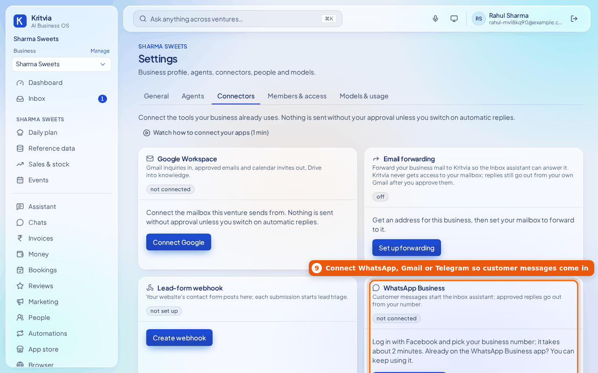

## 10. Connect WhatsApp

Choose **The number on my WhatsApp Business app** (it keeps working in the app on your phone) or
**A new number**, then click **Connect WhatsApp**, log in with Facebook in the window that opens and
pick your business. For the app number, open the WhatsApp Business app on your phone and scan the
QR code Meta shows. Your chats stay on the phone; new ones also arrive in Kritvia.
Details: [agents/whatsapp.md](agents/whatsapp.md).

## 11. Add your prices

**Rate card** → **Add item** for each thing you sell, with its rate, then **Save rate card**.
Proposals and replies quote prices only from here; the AI never makes a price up.

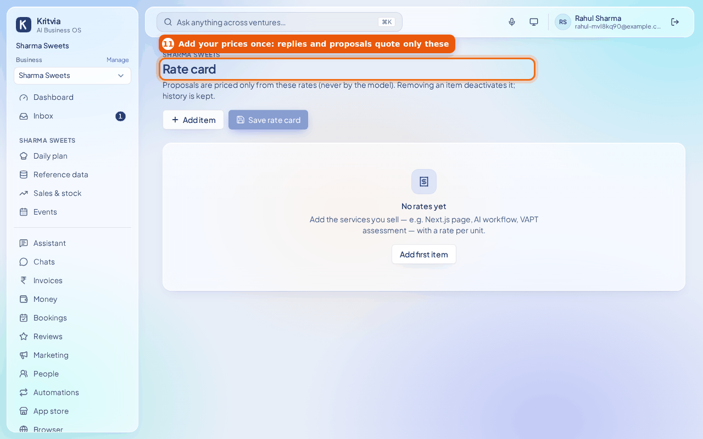

## 12. Optional: let it answer customers by itself

With autopilot on (step 5) this is already done. Without it: **Agents → Inbox assistant**, two options,
both off until you tick them and click **Save**:

- **Answer customers' questions about their own records by themselves**: a customer's own
  invoices, payment links, bookings and shipments, with numbers taken from your records.
- **Reply to customers by itself**: every customer message gets a friendly reply straight away,
  in their language, on the channels you tick, in the tone you pick. Prices not in your records,
  discounts, refunds, disputes, complaints, orders, bookings, payments and anything the agent isn't
  sure of still come to you; the customer is told the team will get back to them. It never
  pretends to be a person.

Details: [agents/answering-machine.md](agents/answering-machine.md).

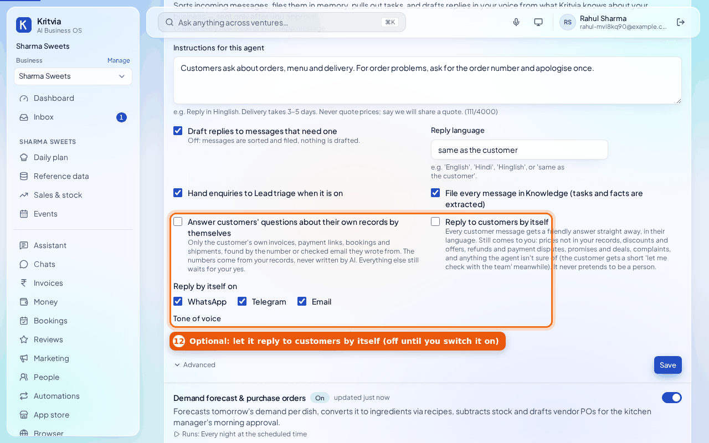

## 13. Ask Kritvia from anywhere

**Your account → Ask Kritvia from anywhere.** Link your own Telegram, WhatsApp, Slack or email and ask
the business anything from there ("who owes us money?", "today's bookings?"). Answers come from
your records, and drafts that need your yes arrive in the chat with Approve and Reject buttons.

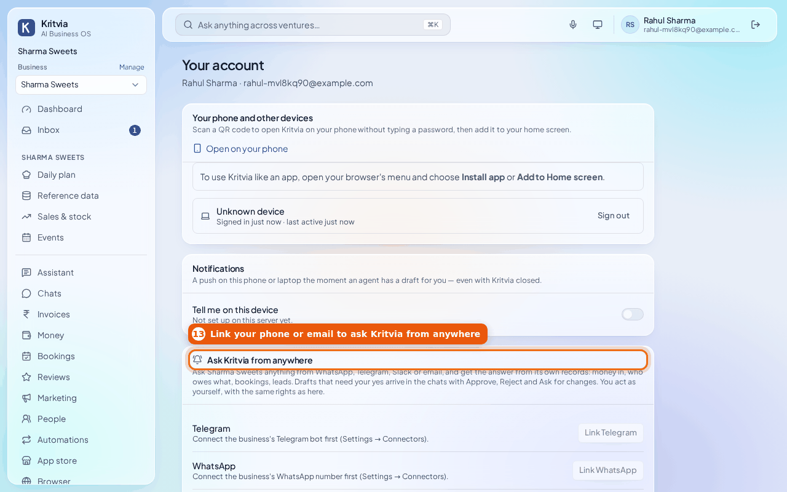

---

## Next

- Upload documents under **Knowledge** (or connect Google Drive) so drafts can cite your own pages.
- Invite your team under **Settings → Members & access**.
- Turn on notifications on your phone from **Your account** so drafts reach you straight away.

The screenshots were taken on 23 October 2026 from a local copy of the app with example data and a
stand-in model, so the wording of a draft you see will differ. Retake them when these screens change.
